<picture>
  <source media="(prefers-color-scheme: dark)" srcset="https://capsule-render.vercel.app/api?type=waving&color=0:0d1117,50:0a66c2,100:58a6ff&height=180&section=header&text=%C3%8Dtalo%20Leal&fontSize=46&fontColor=ffffff&fontAlignY=36&desc=Information%20Systems%20%40%20UFMG%20%E2%80%A2%20Enterprise%20%26%20AI%20Engineering&descSize=16&descAlignY=58&animation=fadeIn">
  <source media="(prefers-color-scheme: light)" srcset="https://capsule-render.vercel.app/api?type=waving&color=0:0969da,50:1f6feb,100:54aeff&height=180&section=header&text=%C3%8Dtalo%20Leal&fontSize=46&fontColor=ffffff&fontAlignY=36&desc=Information%20Systems%20%40%20UFMG%20%E2%80%A2%20Enterprise%20%26%20AI%20Engineering&descSize=16&descAlignY=58&animation=fadeIn">
  
</picture>

<picture>
  <source media="(prefers-color-scheme: dark)" srcset="https://readme-typing-svg.demolab.com?font=Fira+Code&weight=600&size=20&duration=3000&pause=1000&color=58A6FF&center=true&vCenter=true&width=760&lines=Software+Engineer+%40+Seidor+Brasil+%7C+SAP+S%2F4HANA;AI+Engineering%2C+ML+%26+Process+Automation;1st+Place+Hackathon+Banco+Inter+(700%2B+devs)+%7C+2x+Gold+ONC;President+%40+Liga+UFMG+ISMART+%7C+DACOMPSI+%40+UFMG">
  <source media="(prefers-color-scheme: light)" srcset="https://readme-typing-svg.demolab.com?font=Fira+Code&weight=600&size=20&duration=3000&pause=1000&color=0969DA&center=true&vCenter=true&width=760&lines=Software+Engineer+%40+Seidor+Brasil+%7C+SAP+S%2F4HANA;AI+Engineering%2C+ML+%26+Process+Automation;1st+Place+Hackathon+Banco+Inter+(700%2B+devs)+%7C+2x+Gold+ONC;President+%40+Liga+UFMG+ISMART+%7C+DACOMPSI+%40+UFMG">
  
</picture>

 

 

### 🛠️ Tech Stack

  

  

### 💼 LinkedIn Highlights & Feed

 

<!-- Automated daily cards powered by alexcerezo/linkedin-cards -->
<!-- BEGIN LINKEDIN-CARDS -->

  

<!-- END LINKEDIN-CARDS -->

 

### 📊 GitHub Analytics

<picture>
  <source media="(prefers-color-scheme: dark)" srcset="https://github-readme-stats.vercel.app/api?username=Lealwbs&show_icons=true&bg_color=0d1117&border_color=30363d&title_color=58a6ff&text_color=c9d1d9&icon_color=58a6ff">
  <source media="(prefers-color-scheme: light)" srcset="https://github-readme-stats.vercel.app/api?username=Lealwbs&show_icons=true&bg_color=ffffff&border_color=d0d7de&title_color=0969da&text_color=24292f&icon_color=0969da">
  
</picture>
<picture>
  <source media="(prefers-color-scheme: dark)" srcset="https://github-readme-stats.vercel.app/api/top-langs/?username=Lealwbs&layout=compact&bg_color=0d1117&border_color=30363d&title_color=58a6ff&text_color=c9d1d9">
  <source media="(prefers-color-scheme: light)" srcset="https://github-readme-stats.vercel.app/api/top-langs/?username=Lealwbs&layout=compact&bg_color=ffffff&border_color=d0d7de&title_color=0969da&text_color=24292f">
  
</picture>

 

<picture>
  <source media="(prefers-color-scheme: dark)" srcset="https://streak-stats.demolab.com?user=Lealwbs&theme=github-dark-blue&background=0d1117&border=30363d">
  <source media="(prefers-color-scheme: light)" srcset="https://streak-stats.demolab.com?user=Lealwbs&theme=default&background=ffffff&border=d0d7de">
  
</picture>

  

### 👾 Contribution Graph

<picture>
  <source media="(prefers-color-scheme: dark)" srcset="https://raw.githubusercontent.com/lealwbs/lealwbs/output/pacman-contribution-graph-dark.svg">
  <source media="(prefers-color-scheme: light)" srcset="https://raw.githubusercontent.com/lealwbs/lealwbs/output/pacman-contribution-graph.svg">
  
</picture>

<picture>
  <source media="(prefers-color-scheme: dark)" srcset="https://capsule-render.vercel.app/api?type=waving&color=0:0d1117,50:0a66c2,100:58a6ff&height=90&section=footer">
  <source media="(prefers-color-scheme: light)" srcset="https://capsule-render.vercel.app/api?type=waving&color=0:0969da,50:1f6feb,100:54aeff&height=90&section=footer">
  
</picture>

